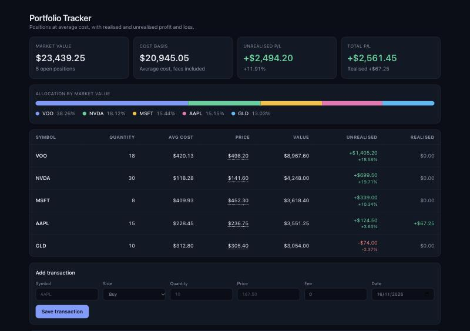

# Portfolio Tracker

A small, production-minded investment portfolio tracker. Record buy and sell transactions, set prices, and see positions at average cost with realised and unrealised profit and loss.



**Stack:** Next.js 15 · React 19 · TypeScript · Tailwind CSS · Python 3.12 · FastAPI · SQLAlchemy 2 · Alembic · PostgreSQL · Redis · Docker · GitHub Actions · PM2 · Nginx

## What it does

- Records buy and sell transactions with fees, validated on the server.
- Replays trades in date order and **rejects any sale larger than the holding on that date**, including when a deletion would make an earlier-recorded sale invalid.
- Computes positions with the **average cost method**: fees are added to cost on buys and deducted from proceeds on sells.
- Shows market value, unrealised and realised P/L, total P/L and allocation.
- Positions without a price are valued at cost and listed clearly, never silently treated as zero.
- Caches prices in Redis, invalidated on every price update. If Redis is down, the API keeps working and reads from PostgreSQL.

## Money rules

| Rule | Why |
| --- | --- |
| All amounts are `Decimal` in Python and `NUMERIC` in PostgreSQL | No floating-point drift in money |
| The API returns amounts as strings (`"540.00"`) | JSON numbers would lose precision in JavaScript |
| Money is rounded to cents with half-up rounding, only at the edges | Intermediate maths keeps full precision |
| Trades are replayed by `(date, id)` | Same-day trades apply in the order they were recorded |

The portfolio maths lives in one pure module, [`api/app/portfolio.py`](api/app/portfolio.py), with no database or web code, so it is easy to test.

## Architecture

```
Browser ──► Next.js (3000) ──/api/*──► FastAPI (8000) ──► PostgreSQL
              server-side proxy           │
              adds X-API-Key              └──► Redis (price cache)
```

The browser only talks to Next.js. A server-side route handler forwards `/api/*` to FastAPI and adds the API key from the server environment, so the key never reaches the browser.

## API

| Method | Path | Description |
| --- | --- | --- |
| GET | `/api/health` | Database and cache status (503 if the database is down) |
| GET | `/api/transactions?symbol=` | Transactions, newest first |
| POST | `/api/transactions` | Add a transaction (422 on invalid input or oversell) |
| DELETE | `/api/transactions/{id}` | Delete (409 if a later sale depends on it) |
| GET | `/api/positions` | Open positions with P/L and allocation |
| GET | `/api/summary` | Portfolio totals |
| GET | `/api/prices` | Stored prices |
| PUT | `/api/prices/{symbol}` | Set a price |

Write routes require `X-API-Key` when `API_KEY` is set. Every response carries an `X-Request-ID`, which also appears in the logs.

## Run it

**With Docker**

```bash
cp .env.example .env
docker compose up --build
docker compose exec api python -m app.seed
```

Open http://localhost:3000.

**Without Docker** (SQLite and an in-memory cache, nothing else to install)

```bash
cd api
python3.12 -m venv .venv && .venv/bin/pip install -r requirements-dev.txt
DATABASE_URL=sqlite:///./portfolio.db .venv/bin/alembic upgrade head
DATABASE_URL=sqlite:///./portfolio.db .venv/bin/python -m app.seed
DATABASE_URL=sqlite:///./portfolio.db .venv/bin/uvicorn app.main:create_app --factory --port 8000
```

```bash
cd web
npm ci && npm run dev
```

The seed data is demo data, not live quotes.

## Tests and CI

```bash
cd api && .venv/bin/pytest -q
cd web && npm test && npm run lint && npm run typecheck
```

GitHub Actions runs on every push and pull request:

1. **API:** Ruff lint and format check, Alembic migrations applied to a real PostgreSQL service and checked against the models, and pytest against PostgreSQL.
2. **Web:** ESLint, TypeScript, Vitest and a production build.
3. **Docker:** validates the compose file and builds both images.

## Deploying to a Linux server

The [`deploy/`](deploy) folder has the PM2 process file and the Nginx site used for a single-server setup (Ubuntu, PM2, Nginx, Let's Encrypt). The server setup, zero-downtime deploys, backups and health monitoring are covered in my companion repo, [server-deploy-toolkit](https://github.com/fawwazkhan-creator/server-deploy-toolkit).

With the toolkit, set `API_APP=app.main:create_app` and `API_FACTORY=1` in the server's `.env`, because this API is built by an app factory.

Release steps in short:

1. Check out the release into `/srv/portfolio-tracker/releases/<sha>` and link `shared/.env` into `api/.env`.
2. `pip install -r api/requirements.txt` into `api/.venv`, then `alembic upgrade head`.
3. `npm ci && npm run build` in `web`, then copy `.next/static` and `public` into `.next/standalone`.
4. Point the `current` symlink at the release, then run `pm2 reload deploy/ecosystem.config.js` and check `/api/health`.

## Known limits and next steps

- **Single user.** There are no user accounts; the API key protects the API, not the web page. Next step: session auth in front of the web app.
- **Manual prices.** Prices are entered by hand. Next step: a scheduled job pulling quotes from a market data provider into the same cache.
- **Concurrent sales.** Two sales of the same symbol submitted at the same moment could both pass validation. Next step: lock the symbol's rows (`SELECT ... FOR UPDATE`) inside the transaction.
- **One currency.** Next step: store a currency per transaction and convert with dated FX rates.

## How I built this

I used Claude Code as a pair programmer for most first drafts. I scoped each task, reviewed every change, and made sure I can explain every line. The money rules, the oversell checks and the tests are the parts I spent the most time on.

## Licence

MIT
